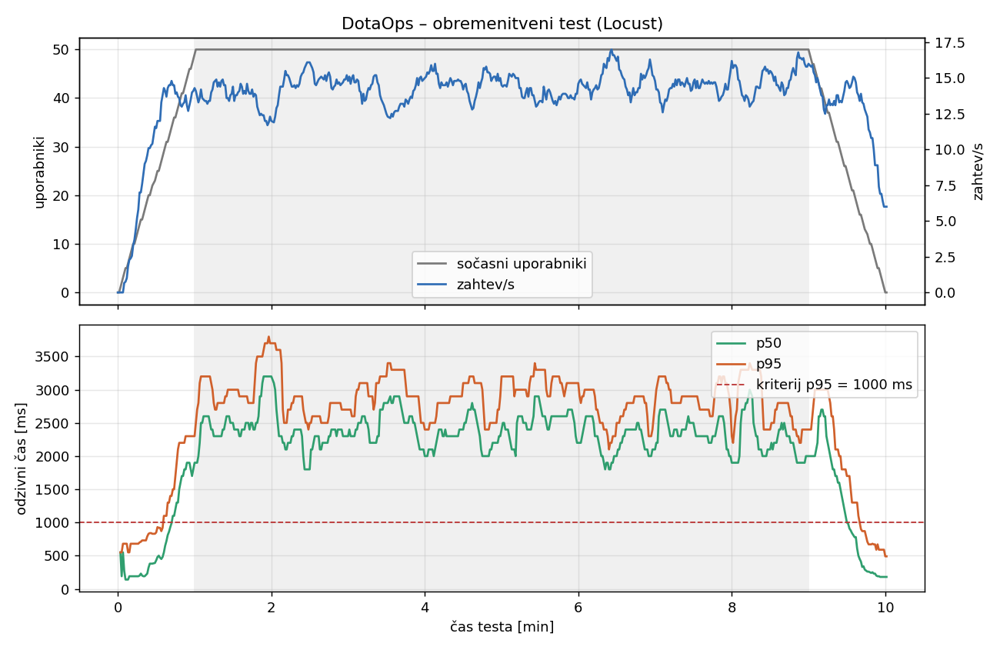

# Poročilo sistemskega testiranja – obremenitveni test z orodjem Locust

**Projekt:** DotaOps  
**Datum izvedbe:** 4. 11. 2026, 15:21–15:31 (Europe/Ljubljana)  
**Odgovorni član:** _ime in priimek_  
**Izbrani tip testa:** obremenitveno testiranje (load test)  
**Orodje:** Locust 2.47.0 (Python 3.13)

## 1. Izbira orodja

Locust je odprtokodno orodje za obremenitveno testiranje, v katerem se obnašanje uporabnikov opiše s Python kodo. Izbrali smo ga, ker:

- omogoča realističen scenarij (več različnih nalog z utežmi, čas razmisleka med koraki, dinamični podatki iz baze),
- s pomočjo razreda `LoadTestShape` natančno določi profil obremenitve (naraščanje → stabilna faza → zmanjševanje),
- samodejno meri odzivne čase (p50/p95/p99), prepustnost in napake ter jih izvozi v CSV in HTML,
- lahko teče brez grafičnega vmesnika (`--headless`), zato je test ponovljiv.

## 2. Kaj preverjamo

### Cilj

Preveriti, ali DotaOps pri **pričakovani največji obremenitvi** (dan turnirja, 50 sočasnih obiskovalcev javnega dela) ostane razpoložljiv, dovolj odziven in stabilen skozi daljši čas. Ne iščemo meje zmogljivosti (to bi bil stresni test), temveč preverjamo delovanje pri realnem prometu.

### Scenarij

Simuliran je anonimni obiskovalec, ki brska po javnem delu aplikacije. Kliče iste API-je, kot jih kliče frontend; vsi podatki prihajajo iz Supabase PostgreSQL baze. Vsak uporabnik med koraki počaka naključno 1–3 s (čas razmisleka).

| Korak uporabnika | Utež | Klicani endpointi |
| --- | ---: | --- |
| Pregled kataloga turnirjev (strani 1–3) | 5 | `GET /api/public/tournaments?page=n` |
| Odpre turnir in 1–2 zavihka | 4 | `GET /api/public/tournaments/{id}` + `/standings`, `/bracket`, `/matches` ali `/teams` |
| Pregled ekip in odpre ekipo | 3 | `GET /api/teams`, `/api/teams/by-slug/{slug}`, `/members` |
| Odpre turnir prek slug-a | 2 | `GET /api/tournaments`, `/api/tournaments/{slug}` |
| Analitika | 2 | `GET /api/public/analytics/{heroes\|teams\|players\|tournaments}` |
| Seznam junakov | 1 | `GET /api/lookups/heroes` |

ID-ji turnirjev in ekip se ob zagonu testa preberejo iz baze (28 turnirjev, 20 ekip), zato uporabniki odpirajo resnične, različne zapise. Vsak odgovor se validira: zahteva je uspešna le, če vrne HTTP 200 in veljaven JSON s poljem `data` (časovna omejitev 10 s).

### Pogoji izvajanja

| Nastavitev | Vrednost |
| --- | --- |
| Profil obremenitve | 0–1 min: naraščanje do 50 uporabnikov (1 uporabnik/s); 1–9 min: stabilno 50 uporabnikov; 9–10 min: zmanjševanje na 0 |
| Trajanje | 10 min (stabilna faza 8 min) |
| Backend | Spring Boot 4 (Java 23, `mvnw spring-boot:run`), lokalno na `http://localhost:8080` |
| Baza | Supabase PostgreSQL 17, regija eu-west-1, prek Session Poolerja; HikariCP privzeto **največ 3 povezave** (`DB_POOL_MAX_SIZE`) |
| Strojna oprema | Windows 11, Intel Core i9-13900K (32 niti), 32 GB RAM; generator obremenitve teče na istem računalniku |
| Zunanje storitve | OpenDota in Steam se ne kličeta |

### Merjene metrike in kriteriji sprejemljivosti

Kriteriji so bili določeni pred izvedbo testa.

| # | Metrika | Kriterij |
| --- | --- | --- |
| K1 | Delež neuspelih zahtev | ≤ 1 % |
| K2 | Odzivni čas p95 (vse zahteve) | ≤ 1000 ms |
| K3 | Odzivni čas p95 posameznega endpointa | ≤ 1500 ms |
| K4 | Prepustnost v stabilni fazi | ≥ 20 zahtev/s |
| K5 | Stabilnost: p95 v zadnjih 2 min stabilne faze glede na prvi 2 min | ≤ 1,25 × |
| K6 | Pomnilnik backend procesa | brez stalnega naraščanja |

Poraba CPU in pomnilnika backend procesa se je vzorčila vsakih 5 s (skripta `monitor-backend.ps1`).

## 3. Rezultati

### Povzetek glede na kriterije

| # | Izmerjeno | Kriterij | Izid |
| --- | --- | --- | --- |
| K1 | 0 neuspelih od 8262 zahtev (0 %) | ≤ 1 % | ✅ ustreza |
| K2 | p95 = **3100 ms** (p50 2300 ms, p99 3400 ms, max 4549 ms) | ≤ 1000 ms | ❌ ne ustreza |
| K3 | p95 med 2800 in 3300 ms na vseh 16 endpointih | ≤ 1500 ms | ❌ ne ustreza |
| K4 | **14,4 zahtev/s** (6916 zahtev v 8 min) | ≥ 20 zahtev/s | ❌ ne ustreza |
| K5 | p95 2800 ms (prvi 2 min) → 2800 ms (zadnji 2 min) = 1,00 × | ≤ 1,25 × | ✅ ustreza |
| K6 | 339 MB → 340 MB (working set) | brez rasti | ✅ ustreza |

### Rezultati po endpointih (celoten test)

| Endpoint | Zahtev | Napak | Povp. [ms] | p50 | p95 | p99 |
| --- | ---: | ---: | ---: | ---: | ---: | ---: |
| `GET /api/public/tournaments` | 1345 | 0 | 2091 | 2200 | 3000 | 3300 |
| `GET /api/public/tournaments/{id}` | 1044 | 0 | 2462 | 2600 | 3300 | 3700 |
| `GET /api/public/tournaments/{id}/bracket` | 397 | 0 | 2264 | 2400 | 3100 | 3400 |
| `GET /api/public/tournaments/{id}/matches` | 381 | 0 | 2225 | 2400 | 3200 | 3400 |
| `GET /api/public/tournaments/{id}/standings` | 391 | 0 | 2084 | 2200 | 3000 | 3300 |
| `GET /api/public/tournaments/{id}/teams` | 394 | 0 | 2230 | 2300 | 3100 | 3400 |
| `GET /api/teams` | 803 | 0 | 2128 | 2200 | 3000 | 3200 |
| `GET /api/teams/by-slug/{slug}` | 800 | 0 | 2123 | 2200 | 2900 | 3200 |
| `GET /api/teams/by-slug/{slug}/members` | 798 | 0 | 2120 | 2200 | 3000 | 3200 |
| `GET /api/tournaments` | 549 | 0 | 2133 | 2200 | 3000 | 3300 |
| `GET /api/tournaments/{slug}` | 546 | 0 | 2090 | 2200 | 2900 | 3200 |
| `GET /api/public/analytics/heroes` | 128 | 0 | 2035 | 2100 | 2800 | 3000 |
| `GET /api/public/analytics/players` | 138 | 0 | 2002 | 2100 | 2900 | 3200 |
| `GET /api/public/analytics/teams` | 132 | 0 | 2073 | 2100 | 3000 | 3100 |
| `GET /api/public/analytics/tournaments` | 131 | 0 | 2024 | 2100 | 2800 | 3000 |
| `GET /api/lookups/heroes` | 285 | 0 | 2039 | 2100 | 2900 | 3300 |
| **Skupaj** | **8262** | **0** | **2165** | **2300** | **3100** | **3400** |

### Potek testa



| Čas | Uporabniki | Zahtev/s | p50 [ms] | p95 [ms] |
| --- | ---: | ---: | ---: | ---: |
| 0:30 | 24 | 11,5 | 430 | 850 |
| 1:00 | 49 | 14,3 | 1900 | 2300 |
| 3:00 | 50 | 14,8 | 2300 | 2700 |
| 5:00 | 50 | 14,5 | 2400 | 3200 |
| 7:00 | 50 | 14,8 | 2100 | 2800 |
| 9:00 | 50 | 16,0 | 2000 | 2400 |
| 10:00 | 0 | 6,0 | 180 | 490 |

Poraba virov backend procesa v stabilni fazi: CPU povprečno 0,1 % računalnika (največ 0,2 %), pomnilnik 339–340 MB, število niti je naraslo s 67 na 108.

## 4. Analiza

- **Zanesljivost in stabilnost sta dobri.** V 10 minutah ni bilo nobene napake, odzivni časi se med stabilno fazo niso slabšali in pomnilnik ni naraščal, kar kaže, da ni uhajanja virov.
- **Prepustnost se ustavi pri ~14–15 zahtev/s že pri 25–30 uporabnikih.** Med naraščanjem obremenitve je p95 presegel 1000 ms približno pri 30 uporabnikih (≈ 35 s testa). Nadaljnji uporabniki niso povečali prepustnosti, temveč samo čakalni čas.
- **Vsi endpointi so enako počasni (~2,1 s), ne glede na zahtevnost.** Seznam junakov brez obremenitve vrne odgovor v ~110 ms, pod obremenitvijo pa v ~2 s. To ne kaže na počasne poizvedbe, temveč na skupno čakalno vrsto, v kateri čakajo vse zahteve.
- **Backend med testom praktično ne porablja CPU-ja**, število niti pa naraste – niti čakajo.
- **Ozko grlo je najverjetneje bazen povezav z bazo.** Backend uporablja privzeto največ 3 povezave HikariCP, vsaka zahteva pa povezavo zasede ~200 ms zaradi omrežne zakasnitve do Supabase v regiji eu-west-1. Teoretična zgornja meja je zato 3 povezave ÷ 0,2 s ≈ 15 zahtev/s, kar se ujema z izmerjenimi 14,4 zahtev/s. Hipoteze nismo potrdili s ponovitvijo testa z večjim bazenom.

## 5. Sklep

Sistem **ne ustreza** postavljenim kriterijem pri pričakovani obremenitvi 50 sočasnih uporabnikov: zanesljivost (K1), stabilnost (K5) in poraba pomnilnika (K6) so ustrezni, odzivni čas (K2, K3) in prepustnost (K4) pa ne. Ob trenutni konfiguraciji DotaOps znotraj kriterijev postreže približno 25–30 sočasnih uporabnikov.

**Priporočila:**

1. Povečati bazen povezav (npr. `DB_POOL_MAX_SIZE=10`) v skladu z omejitvami povezav izbranega Supabase paketa in test ponoviti z enakim profilom.
2. Zmanjšati število poizvedb na zahtevo pri najpočasnejšem endpointu `GET /api/public/tournaments/{id}` (povp. 2462 ms).
3. Za javne podatke, ki se redko spreminjajo (junaki, analitika, katalog turnirjev), uvesti predpomnjenje.

## 6. Omejitve

- Backend je tekel v razvojnem načinu (`spring-boot:run`) na lokalnem računalniku, ne v produkcijskem okolju. Generator obremenitve je tekel na istem računalniku; pri ~14 zahtevah/s na 32-nitnem procesorju je njegov vpliv zanemarljiv, poraba CPU samega Locusta pa ni bila merjena.
- Merjen je bil samo javni (anonimni) del API-ja. Prijavljeni uporabniki, pisalne operacije, frontend (Next.js) in OpenDota uvoz niso bili vključeni.
- Rezultati so odvisni od omrežne povezave do Supabase (eu-west-1) in od trenutne količine podatkov v bazi.

## 7. Dodatne ugotovitve med testiranjem

- `GET /api/public/tournaments` vrača `totalElements: 38` in `totalPages: 4`, dejansko pa vrne samo 28 turnirjev na treh straneh (stran 4 je prazna).
- Na prvi strani je zastavica `hasPrevious` napačno nastavljena na `true`; parameter `size` je prezrt (velikost strani je vedno 10).

## 8. Ponovitev testa

Datoteke so v mapi [`scripts/locust-loadtest/`](../scripts/locust-loadtest/): `locustfile.py` (scenarij in profil), `monitor-backend.ps1` (vzorčenje CPU/pomnilnika), `analyze.py` (izračun metrik), `plot.py` (graf). Surovi rezultati (CSV, HTML poročilo Locusta, vzorci virov) so v `scripts/locust-loadtest/results/`.

```powershell
cd scripts\locust-loadtest
pip install locust==2.47.0
# v drugem oknu: powershell -File monitor-backend.ps1 -DurationSeconds 630
python -m locust -f locustfile.py --host http://localhost:8080 --headless `
    --csv results/load --csv-full-history --html results/load-report.html
python analyze.py
python plot.py
```
